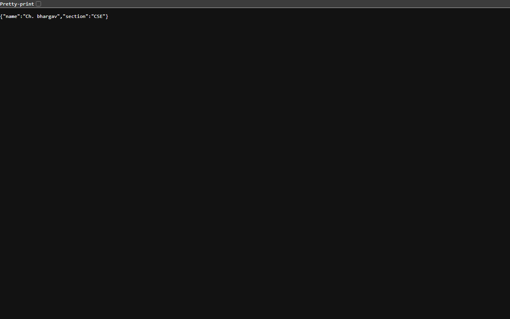

# Lab 1: Node.js and Express Server

## Student Details

- **Name:** Ch. bhargav
- **Registration Number:** 252U1R1055
- **Section:** CSE
- **Course:** Backend Development Fundamentals
- **Lab Number:** 01

## Live Link

**Deployment Status:** Local Development (`http://localhost:3000`)
*(Cloud deployment is pending external platform account authorization. See deployment guide below for steps to deploy to Render or Vercel).*

## Objective

To initialize a Node.js project, understand `package.json` configuration, create a basic HTTP server using Node.js's built-in `http` module, and build an Express server handling multiple routes with proper HTTP status codes.

## Technologies Used

- **Node.js** (v24.16.0) - JavaScript runtime environment
- **Express.js** (v5.3.0) - Fast, minimalist web framework for Node.js
- **JavaScript (CommonJS)** - Backend application programming language
- **npm** (v11.13.0) - Node package manager
- **Git** - Distributed version control

## Project Structure

```text
lab-01/
├── screenshots/
│   ├── home.png
│   ├── about.png
│   ├── time.png
│   └── not-found.png
├── server-http.js
├── server.js
├── package.json
├── package-lock.json
├── .gitignore
└── README.md
```

## Installation and Setup

### `package.json` Explanation

The `package.json` file is the manifest of the Node.js project. Key fields include:
- `name`: Specifies the unique name of the project package (`lab-01`).
- `version`: Indicates the current version of the project (`1.0.0`) following semantic versioning.
- `main`: Designates the primary entry point file of the application (`server.js`).
- `scripts`: Defines custom executable shell commands (e.g., `"start": "node server.js"`).
- `dependencies`: Lists required runtime packages and their version ranges (e.g., `"express": "^5.3.0"`).

### Prerequisites

- Node.js (v18+) and npm installed on your system.
- Terminal or command-line interface.

### Steps to Run

1. Clone or navigate to the repository directory:
   ```bash
   cd backend_labs/lab-01
   ```

2. Install the necessary project dependencies:
   ```bash
   npm install
   ```

3. Start the Express server:
   ```bash
   node server.js
   # or
   npm start
   ```

4. Open your browser or API client and visit:
   `http://localhost:3000`

### How to Run the Basic HTTP Server

To test the standalone server built with Node.js's native `http` module:

```bash
node server-http.js
```

> **Note:** Stop any active server (`Ctrl + C`) before starting another server since both bind to port `3000` by default.

## Endpoints

| Method | Endpoint | Description | Expected Status |
|---|---|---|---|
| GET | `/` | Welcome message | 200 OK |
| GET | `/about` | Student name and section in JSON | 200 OK |
| GET | `/time` | Current date and time in JSON | 200 OK |
| GET | `/anything` | Unknown route demonstration | 404 Not Found |

*Note: The `/anything` path is an example. Any undefined route returns HTTP 404.*

## Screenshots

### 1. Home Route (`/`)
Displays the plain-text welcome message.


### 2. About Route (`/about`)
Returns the student's name and section in JSON format.


### 3. Time Route (`/time`)
Returns the server's current date and time in ISO format.


### 4. Unknown Route (`/anything`)
Returns a `404 Not Found` response for unhandled endpoints.


## HTTP Status Codes

- **200 OK:** The request was received, understood, and successfully processed.
- **404 Not Found:** The server cannot find the requested resource or path.

## Viva Questions and Answers

### 1. What is the difference between `package.json` and `node_modules`?
`package.json` is a lightweight configuration file that tracks project metadata, scripts, and list of dependency specifications. `node_modules` is the actual directory containing the installed code and libraries of those dependencies. `package.json` is committed to version control, while `node_modules` is excluded via `.gitignore`.

### 2. What does `app.listen()` do?
`app.listen()` binds the Express application to a specific network port (e.g., 3000) and starts listening for incoming client HTTP requests.

### 3. What do request and response represent?
- **Request (`req`):** An object representing the incoming HTTP request from the client, containing headers, URL path, query parameters, body data, and HTTP method.
- **Response (`res`):** An object used to construct and send the HTTP response back to the client, including status codes, response headers, and response payload (text, HTML, or JSON).

## Problems Faced and Solutions

1. **Headless Chrome Screenshot Path Resolution on Windows:**
   - *Problem:* Running Chrome with relative output path `--screenshot="screenshots/home.png"` failed with error code `0x3` (`The system cannot find the path specified`).
   - *Solution:* Provided fully resolved absolute Windows file paths (`$screenshotDir\home.png`) which successfully generated the PNG screenshot artifacts.

2. **Port 3000 Binding Collision:**
   - *Problem:* Running `server-http.js` and `server.js` simultaneously resulted in `EADDRINUSE` errors because both listen on port 3000 by default.
   - *Solution:* Ensured each process is terminated cleanly before launching the alternative server implementation, and added `process.env.PORT || 3000` to support dynamic environment port allocation.

3. **Parent Directory Git Boundary Discovery:**
   - *Problem:* Running `git status` from subdirectories picked up an accidental `.git` repository located at user home (`C:\Users\bharg`).
   - *Solution:* Explicitly ran `git init -b main` inside `backend_lab` to create an isolated local repository scoped directly to this project.

## Git and Repository Notes

- The `.gitignore` file excludes `node_modules/` and `.env` at both project and lab levels.
- The `node_modules/` directory is never committed to Git.
- Screenshots are saved and tracked in the `screenshots/` directory.
- Changes are pushed to remote repository: `https://github.com/bhargavchavitina-bl/backend_labs.git`.

## Deployment Guide (Render / Vercel)

To deploy the application to a cloud provider:

### Option A: Render
1. Push repository to GitHub.
2. Log into [Render](https://render.com) and create a **New Web Service**.
3. Connect `bhargavchavitina-bl/backend_labs`.
4. Set **Root Directory** to `lab-01`.
5. Set **Build Command** to `npm install`.
6. Set **Start Command** to `node server.js`.
7. Click **Deploy**.

### Option B: Vercel
1. Install Vercel CLI: `npm install -g vercel`.
2. Inside `lab-01`, create `vercel.json` routing configuration if needed.
3. Run `vercel deploy` and follow the command line prompts.
