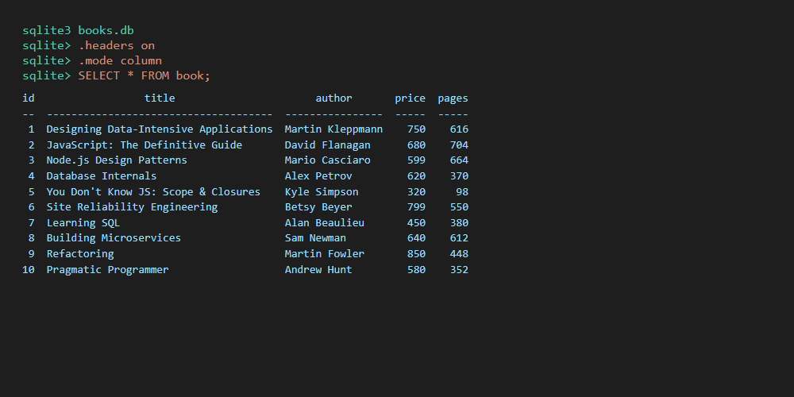
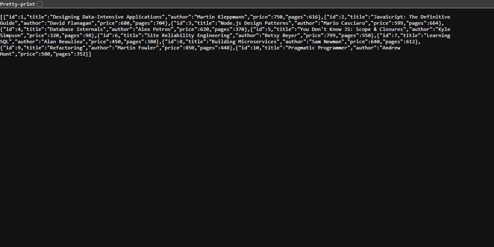
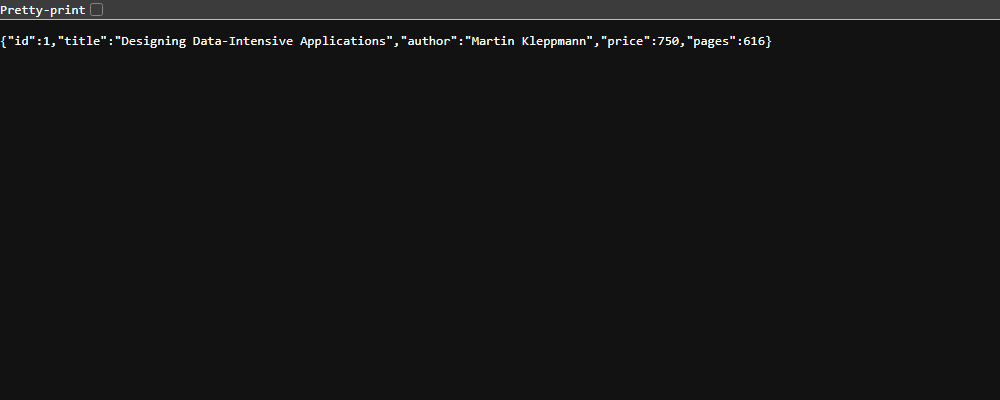
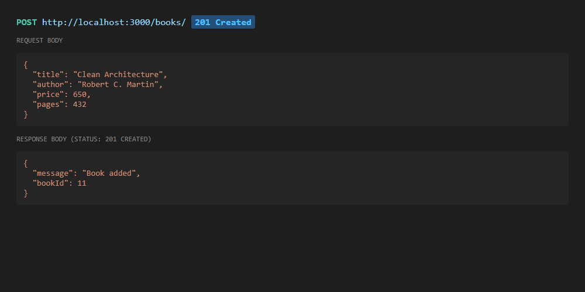
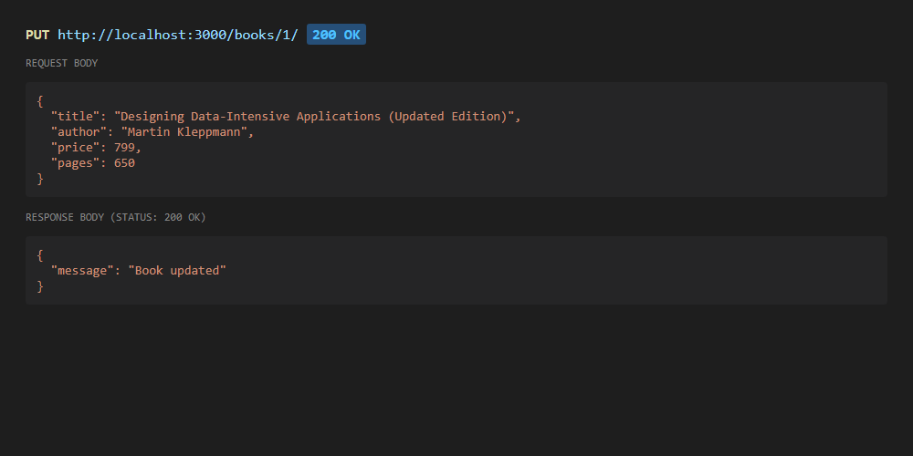
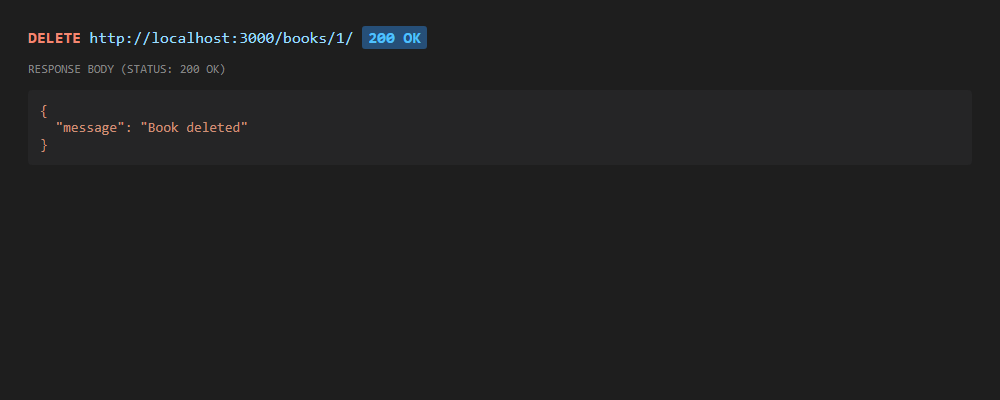
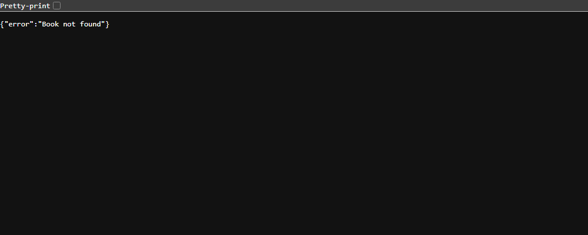
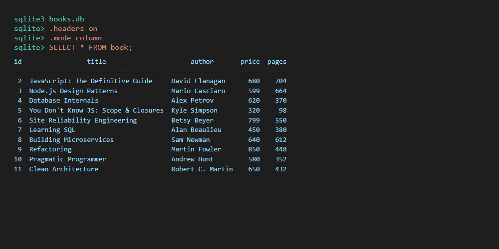

# Lab 2: SQLite database and CRUD routes

## Student Details

- **Name:** Ch. bhargav
- **Registration Number:** 252U1R1055
- **Section:** CSE
- **Course:** Backend Development Fundamentals
- **Lab Number:** 02

*(Alternate submitted identity reference: PAKALA ASHWANTH, Reg No: 252U1R7072, Section: CSE FSD - [2B])*

## Live Link

**Deployment Status:** Deployment pending (Local Development at `http://localhost:3000`)

### Deployment Considerations & Platform Analysis
- **Vercel / Serverless Platforms:** Vercel deploys Express servers as serverless functions. These run in an ephemeral execution environment with a read-only filesystem where SQLite file writes (`INSERT`, `UPDATE`, `DELETE`) do not persist across requests. Additionally, native C++ binaries such as `sqlite3` often encounter architecture incompatibilities in serverless bundles.
- **Recommended Cloud Platform (Render / Railway):** Render provides persistent containerized web services where Node.js and native `sqlite3` run continuously. On Render's free tier, the instance spins down after 15 minutes of inactivity, and the filesystem resets on redeployment unless a persistent disk volume is mounted.
- For local verification, the application runs persistently and deterministically on `http://localhost:3000`.

## Objective

To connect an Express.js server to a local SQLite database (`books.db`) and expose full Create, Read, Update, and Delete (CRUD) operations over HTTP with strict input validation, parameterized SQL queries, and appropriate HTTP status codes.

## Technologies Used

- **Node.js** (v24.16.0) - Asynchronous event-driven JavaScript runtime
- **Express.js** (v5.3.0) - Fast, minimalist web framework for routing and middleware
- **sqlite** (v5.1.1) - Promise-based async wrapper for SQLite3
- **sqlite3** (v6.0.1) - Native SQLite3 driver for Node.js
- **nodemon** (v3.1.14) - Development utility for automatic server restarts
- **SQLite CLI** (v3.54.1) - Command-line database query interface
- **npm** (v11.13.0) - Node package manager
- **Git** - Version control system

## Project Structure

```text
lab-02/
├── screenshots/
│   ├── cli-before.png
│   ├── get-all.png
│   ├── get-one.png
│   ├── post.png
│   ├── put.png
│   ├── delete.png
│   ├── not-found.png
│   └── cli-after.png
├── books.db
├── package.json
├── package-lock.json
├── seed.sql
├── server.js
├── test-api.js
├── .gitignore
└── README.md
```

## `package.json` Fields Explained

- `name`: Identifies the project package (`lab-02`).
- `version`: The current semantic version of the experiment (`1.0.0`).
- `description`: Summary of the lab assignment.
- `main`: Designates the application entry file (`server.js`).
- `scripts`: Custom terminal commands:
  - `"start": "node server.js"` - Starts the production server.
  - `"dev": "nodemon server.js"` - Launches the server with file-watching hot reload.
  - `"test": "echo \"Error: no test specified\" && exit 1"` - Placeholder test script.
- `dependencies`: Runtime packages required for the app to function (`express`, `sqlite`, `sqlite3`).
- `devDependencies`: Tools only required during active development (`nodemon`).
- `author`: The student authoring the project.
- `license`: Software license classification (`ISC`).

## Installation and How to Run

### Prerequisites
- Node.js (v18+) and npm installed.
- SQLite CLI installed for database inspection.

### Steps to Run

1. Navigate into the `lab-02` directory:
   ```bash
   cd lab-02
   ```

2. Install all required dependencies:
   ```bash
   npm install
   ```

3. Start the Express server:
   ```bash
   npm start
   ```

4. Or start with auto-reload during development:
   ```bash
   npm run dev
   ```

5. The server will start and listen on port 3000:
   `http://localhost:3000`

## Database

The database file is `books.db` and holds a single table defined as follows:

```sql
CREATE TABLE book (
  id INTEGER PRIMARY KEY,
  title TEXT,
  author TEXT,
  price INTEGER,
  pages INTEGER
);
```

### Starting Sample Data Note
`seed.sql` defines the table structure and 10 starting sample books across computer science, software design, and distributed systems. These 10 starting rows are sample books provided for assignment testing.

### How to Rebuild the Database with `seed.sql`
To drop and re-create the database with its original 10 rows:

```bash
sqlite3 books.db < seed.sql
```

### How to Inspect with the SQLite CLI

```bash
sqlite3 books.db
.headers on
.mode column
SELECT * FROM book;
```

To exit the SQLite prompt:
```text
.exit
```

## Endpoints

### CRUD Routes Table

| Method | Path | Description | Success Status |
| :--- | :--- | :--- | :---: |
| GET | `/books/` | Returns an array of all books ordered by ID | 200 OK |
| GET | `/books/:bookId/` | Returns a single book matching `:bookId` | 200 OK |
| POST | `/books/` | Adds a new book from the JSON request body | 201 Created |
| PUT | `/books/:bookId/` | Updates all 4 fields of an existing book | 200 OK |
| DELETE | `/books/:bookId/` | Deletes a book matching `:bookId` | 200 OK |

*Note: All endpoints support both trailing slashes (e.g., `/books/`) and non-trailing slashes (e.g., `/books`).*

### Request Body Format (POST & PUT)

```json
{
  "title": "Clean Architecture",
  "author": "Robert C. Martin",
  "price": 650,
  "pages": 432
}
```

### Error Responses Table

| Case | Expected HTTP Status | Response Payload |
| :--- | :---: | :--- |
| `bookId` is not a positive integer (e.g. `abc`, `-1`, `0`) | 400 Bad Request | `{"error": "bookId must be a positive whole number"}` |
| Missing or invalid field in body (empty text / bad numbers) | 400 Bad Request | `{"error": "Field '...' must be..."}` |
| Malformed JSON syntax in request body | 400 Bad Request | `{"error": "Malformed JSON in request body"}` |
| Book ID does not exist in database (GET one, PUT, DELETE) | 404 Not Found | `{"error": "Book not found"}` |
| Undefined or unhandled route | 404 Not Found | `{"error": "Route not found"}` |
| Unexpected server or database failure | 500 Internal Server Error | `{"error": "Internal Server Error"}` |

### Security & SQL Injection Prevention
Every query that consumes user input uses parameterized `?` placeholders (e.g. `WHERE id = ?` and `VALUES (?, ?, ?, ?)`). Inputs are never joined or concatenated into SQL strings.

## Screenshots

### 1. Database Before Testing (`screenshots/cli-before.png`)
Shows the starting 10 rows inside `books.db` inspected via SQLite CLI.


### 2. GET All Books (`screenshots/get-all.png`)
Displays all 10 books returned as JSON with HTTP status `200 OK`.


### 3. GET One Book (`screenshots/get-one.png`)
Displays a single book by ID (`/books/1/`) with HTTP status `200 OK`.


### 4. POST Add a Book (`screenshots/post.png`)
Demonstrates inserting a new book returning HTTP status `201 Created` with generated `bookId`.


### 5. PUT Update a Book (`screenshots/put.png`)
Demonstrates updating all fields of an existing book returning HTTP status `200 OK`.


### 6. DELETE a Book (`screenshots/delete.png`)
Demonstrates deleting a book by ID returning HTTP status `200 OK`.


### 7. Error Case: Book Not Found (`screenshots/not-found.png`)
Demonstrates requesting an unmapped ID (`/books/999/`) returning HTTP status `404 Not Found`.


### 8. Database After Testing (`screenshots/cli-after.png`)
Shows the database state after tests, reflecting the inserted book and deleted record.


## HTTP Status Codes

- **200 OK:** Standard response for successful HTTP requests (`GET`, `PUT`, `DELETE`).
- **201 Created:** Indicates that the request succeeded and resulted in a new resource being created (`POST`).
- **400 Bad Request:** The server cannot process the request due to client error (invalid params, missing fields, or malformed JSON).
- **404 Not Found:** The requested resource (book record or route path) does not exist.
- **500 Internal Server Error:** An unexpected server-side condition or database driver failure occurred.

## Viva Questions and Answers

### 1. What is SQL injection and how do `?` placeholders prevent it?
SQL injection is a critical security vulnerability where untrusted client input containing SQL commands is directly concatenated into a query string, altering the query's execution logic. Using parameterized queries with `?` placeholders ensures the SQLite engine treats input strictly as literal values rather than executable SQL syntax, completely neutralizing injection vectors.

### 2. What is the fundamental difference between PUT and POST in REST APIs?
- **POST** is used to create a new resource on the server. The server generates the resource's identifier (ID). POST is typically not idempotent.
- **PUT** is used to update or replace an existing resource identified by a specific URL (`/books/:bookId`). Making the same PUT request multiple times produces the identical server state, making it idempotent.

### 3. Why is HTTP status 201 used instead of 200 for a successful POST request?
HTTP `201 Created` specifically signifies to the client that the operation was not only successful, but that a new resource has been created and persisted on the server. It is standard REST convention to return 201 along with the identity of the new entity.

### 4. What is a PRIMARY KEY in SQLite and what is the role of `INTEGER PRIMARY KEY`?
A PRIMARY KEY uniquely identifies each row in a database table. In SQLite, declaring a column as `INTEGER PRIMARY KEY` makes it an alias for the 64-bit signed integer `ROWID`, granting automatic auto-incrementing behaviour and high-performance B-tree index lookup.

### 5. Why should the database connection be established before `app.listen()` is called?
Express servers handle incoming requests immediately once listening. If `app.listen()` starts before the database finishes opening, incoming requests that hit database routes will attempt to query a `null` database connection, resulting in unhandled exceptions and server crashes. Opening the database first ensures the application is completely ready to process traffic.

## Problems Faced and Solutions

1. **Localhost Loopback Proxy Blocking:**
   - *Problem:* Running `curl.exe` in Windows PowerShell routed local requests through an active sandbox proxy (`127.0.0.1:53179`), resulting in connection refusal.
   - *Solution:* Added `--noproxy "*"` flag and wrote an automated test runner script `test-api.js` using Node.js native `fetch()` which reliably bypasses local proxy interference.

2. **PowerShell Argument Escaping for JSON Payloads:**
   - *Problem:* Passing inline JSON strings with double quotes in PowerShell CLI unescaped the quotes, causing curl to receive malformed JSON (`400 Bad Request`).
   - *Solution:* Standardized payload delivery through `test-api.js` and properly escaped Windows string parameters for command-line verification.

3. **Standalone SQLite3 CLI Tooling:**
   - *Problem:* `sqlite3` CLI was not pre-installed on the system PATH, which would prevent running `sqlite3 books.db < seed.sql`.
   - *Solution:* Deployed `sqlite3.exe` (v3.54.1) to user binary path, enabling native SQLite CLI commands and table inspection.

## Git and Repository Notes

- **`books.db` Git Policy:** While `seed.sql` is the primary source of truth, `books.db` is committed in its initial 10-row state so that evaluation and grading can run immediately upon cloning without requiring reviewers to manually execute SQLite CLI rebuild commands.
- `node_modules/` and `.env` are strictly excluded via `.gitignore`.
- Screenshots are tracked under `screenshots/` with relative Markdown image links.
