# Lab 3: REST API, query parameters, validation, debugging

## Student Details

- **Name:** PAKALA ASHWANTH
- **Registration Number:** 252U1R7072
- **Section:** CSE FSD - [2B]
- **Course:** Backend Development Fundamentals
- **Lab Number:** 03

## Live Link

**Deployment Status:** Deployment pending (Local Development at `http://localhost:3000`)

### Cloud Deployment Analysis (Render Free Web Service)
- **Execution Environment:** Render runs Node.js applications as persistent web service containers. However, on Render's free tier, instances spin down after 15 minutes of inactivity, resulting in a cold start delay of 50–90 seconds on subsequent requests.
- **Filesystem & Ephemeral Storage:** The filesystem on Render free instances is ephemeral. When the service sleeps or redeploys, SQLite writes (`INSERT`, `UPDATE`, `DELETE`) are reset unless a persistent disk volume is attached.
- **Native Addon Compatibility:** Pinned `sqlite3` to exact version `5.1.7` to prevent pre-built binary mismatch and native build failures across Linux container runtimes on Render.
- **Repository Root Directory:** Because this repository holds multiple lab folders (`lab-01/`, `lab-02/`, `lab-03/`), Render's Root Directory setting must be explicitly set to `lab-03` with Build Command `npm install` and Start Command `npm start`.

## Objective

To upgrade the CRUD routes from Lab 2 into a professional REST API supporting search, column sorting, offset-based pagination, numeric price filtering, strict input validation, uniform error and success response shapes, and comprehensive Postman collection testing.

## Technologies Used

- **Node.js** (v24.16.0) - Asynchronous JavaScript runtime
- **Express.js** (v5.3.0) - Minimalist routing framework
- **sqlite** (v5.1.1) - Promise-based async wrapper for SQLite
- **sqlite3** (v5.1.7) - Pinned SQLite driver for native stability
- **nodemon** (v3.1.14) - Development server live-reload
- **SQLite CLI** (v3.54.1) - Database query and rebuild interface
- **Postman** (v2.1 Collection) - Automated endpoint contract testing
- **npm** (v11.13.0) - Package management
- **Git** - Version control system

## Project Structure

```text
lab-03/
├── screenshots/
│   ├── search.png
│   ├── sort.png
│   ├── pagination.png
│   ├── price-range.png
│   ├── post-created.png
│   ├── put-updated.png
│   ├── delete-deleted.png
│   ├── validation-error.png
│   ├── bad-price.png
│   ├── not-found.png
│   └── runner-results.png
├── books.db
├── lab-03.postman_collection.json
├── package.json
├── package-lock.json
├── seed.sql
├── server.js
├── .gitignore
└── README.md
```

## `package.json` Fields Explained

- `name`: Package identifier (`lab-03`).
- `version`: Semantic version (`1.0.0`).
- `description`: Summary of the Lab 3 assignment.
- `main`: Server entrypoint (`server.js`).
- `scripts`:
  - `"start": "node server.js"` — Starts the Express application.
  - `"dev": "nodemon server.js"` — Starts the application with live file-watching.
  - `"test": "echo \"Error: no test specified\" && exit 1"` — Default test script.
- `dependencies`:
  - `express`: Core routing and middleware framework.
  - `sqlite`: Async/await wrapper for database operations.
  - `sqlite3`: Pinned exact version `5.1.7` for Render compatibility.
- `devDependencies`:
  - `nodemon`: Server reloading utility for development.
- `author`: Student author name (`PAKALA ASHWANTH`).
- `license`: `ISC`.

## Installation and Setup

### Prerequisites
- Node.js (v18+) and npm installed.
- SQLite CLI available on PATH.

### Steps to Run

1. Navigate to the `lab-03` directory:
   ```bash
   cd lab-03
   ```

2. Install dependencies:
   ```bash
   npm install
   ```

3. Rebuild the database from the SQL seed script:
   ```bash
   sqlite3 books.db ".read seed.sql"
   ```
   > **Windows PowerShell Note:** In PowerShell, always use the SQLite CLI command `sqlite3 books.db ".read seed.sql"`. Do not use the `<` input redirection operator, as PowerShell interprets `<` as reserved syntax.

4. Start the server:
   ```bash
   npm start
   # or for live reload:
   npm run dev
   ```

5. The server listens on port 3000 by default:
   `http://localhost:3000`

## Database

The database is stored in `books.db` and consists of a single `book` table with strict `NOT NULL` constraints on all fields:

```sql
DROP TABLE IF EXISTS book;

CREATE TABLE book (
  id INTEGER PRIMARY KEY,
  title TEXT NOT NULL,
  author TEXT NOT NULL,
  price INTEGER NOT NULL,
  pages INTEGER NOT NULL
);
```

### Seed Data
`seed.sql` defines the table structure and 10 starting sample books covering software engineering, distributed systems, and clean coding practices. The starting rows are sample books provided for testing and evaluation.

To inspect the database:
```bash
sqlite3 books.db
.headers on
.mode column
SELECT * FROM book;
.exit
```

## Endpoints, Query Parameters, and Responses

### Endpoints Table

| Method | Path | Description | Success Status |
| :--- | :--- | :--- | :---: |
| GET | `/books/` | List books with search, sort, pagination, and price filter | 200 OK |
| GET | `/books/:bookId/` | Returns a single book by ID | 200 OK |
| POST | `/books/` | Adds a new book from the JSON request body | 201 Created |
| PUT | `/books/:bookId/` | Replaces all fields of an existing book | 200 OK |
| DELETE | `/books/:bookId/` | Deletes a book matching `:bookId` | 200 OK |

*Note: Trailing slashes are optional across all endpoints (e.g. `/books` and `/books/`).*

### Query Parameters for GET `/books/`

| Parameter | Meaning | Default | Allowed Values |
| :--- | :--- | :---: | :--- |
| `search_q` | Case-insensitive title match (`LIKE %...%`) | `""` (all titles) | Any text string |
| `order_by` | Column to sort results by | `id` | `id`, `title`, `author`, `price`, `pages` |
| `order` | Sort direction | `ASC` | `ASC`, `DESC` (case-insensitive) |
| `limit` | Maximum number of books to return | `10` | Whole number from 1 to 100 |
| `offset` | Number of books to skip | `0` | Whole number $\ge 0$ |
| `min_price` | Lowest book price to include | `0` | Whole number $\ge 0$ |
| `max_price` | Highest book price to include | `2147483647` | Whole number $\ge 0$ |

**Example URL:**
`/books/?search_q=the&min_price=200&max_price=500&order_by=price&order=DESC&limit=5&offset=0`

### Request Body for POST and PUT

```json
{
  "title": "Clean Architecture",
  "author": "Robert C. Martin",
  "price": 650,
  "pages": 432
}
```

- `title` and `author` must be non-empty strings.
- `price` and `pages` must be whole numbers $\ge 0$. Non-numeric prices like `"abc"` or negative values are rejected with `400 Bad Request`.

### Standardized Response Shapes

- **Success Responses:**
  - `GET /books/`: Returns JSON array of matching book objects.
  - `GET /books/:bookId/`: Returns single book object.
  - `POST /books/`: Returns `{ "id": <new_id>, "message": "Book added" }`.
  - `PUT /books/:bookId/`: Returns `{ "message": "Book updated" }`.
  - `DELETE /books/:bookId/`: Returns `{ "message": "Book deleted" }`.
- **Error Responses:** Every error returns `{ "message": "..." }`:
  - `400 Bad Request`: Missing/invalid fields, non-numeric ID, bad query parameter, `min_price > max_price`, or malformed JSON.
  - `404 Not Found`: Book ID not found or unhandled route path.
  - `500 Internal Server Error`: Unhandled database or server exception.

## Postman Tests

The collection file `lab-03.postman_collection.json` contains 30 automated test requests verifying every aspect of the API specification.

### How to Import and Run the Collection
1. Open Postman.
2. Click **Import** and select `lab-03/lab-03.postman_collection.json`.
3. In collection variables, verify `baseUrl` is set to `http://localhost:3000`.
4. Click **Run collection** and execute all 30 tests in sequence.
5. The collection is designed to run non-destructively: tests 09–12 create, update, and delete one book, leaving the database with the original 10 rows.

### Success Cases (Tests 01–12)

| # | Test Name | Request | Expected Status |
| :---: | :--- | :--- | :---: |
| 01 | GET all books (defaults: limit 10) | `GET /books/` | 200 OK |
| 02 | GET one book | `GET /books/3/` | 200 OK |
| 03 | Search by title (`search_q=the`) | `GET /books/?search_q=the` | 200 OK |
| 04 | Sort by price descending | `GET /books/?order_by=price&order=DESC&limit=5` | 200 OK |
| 05 | Pagination (`limit=3&offset=3`) | `GET /books/?limit=3&offset=3` | 200 OK |
| 06 | Price range filter | `GET /books/?min_price=250&max_price=400` | 200 OK |
| 07 | All filters combined | `GET /books/?search_q=r&min_price=200&max_price=500&order_by=pages&order=DESC&limit=2&offset=1` | 200 OK |
| 08 | SQL injection text in search | `GET /books/?search_q=%27%20OR%201%3D1%20--` | 200 OK |
| 09 | POST create a book | `POST /books/` | 201 Created |
| 10 | PUT update the new book | `PUT /books/{{newBookId}}/` | 200 OK |
| 11 | GET the updated book | `GET /books/{{newBookId}}/` | 200 OK |
| 12 | DELETE the new book | `DELETE /books/{{newBookId}}/` | 200 OK |

### Failure Cases (Tests 13–30)

| # | Test Name | Request | Expected Status |
| :---: | :--- | :--- | :---: |
| 13 | GET book that does not exist | `GET /books/999/` | 404 Not Found |
| 14 | GET with non-numeric id | `GET /books/abc/` | 400 Bad Request |
| 15 | GET after delete | `GET /books/{{newBookId}}/` | 404 Not Found |
| 16 | DELETE same book again | `DELETE /books/{{newBookId}}/` | 404 Not Found |
| 17 | PUT book that does not exist | `PUT /books/999/` | 404 Not Found |
| 18 | POST missing title | `POST /books/` | 400 Bad Request |
| 19 | POST missing author | `POST /books/` | 400 Bad Request |
| 20 | POST non-numeric price | `POST /books/` | 400 Bad Request |
| 21 | POST negative price | `POST /books/` | 400 Bad Request |
| 22 | POST malformed JSON | `POST /books/` | 400 Bad Request |
| 23 | PUT with invalid body | `PUT /books/1/` | 400 Bad Request |
| 24 | Invalid order_by column | `GET /books/?order_by=hack` | 400 Bad Request |
| 25 | Invalid order direction | `GET /books/?order=SIDEWAYS` | 400 Bad Request |
| 26 | Limit is zero | `GET /books/?limit=0` | 400 Bad Request |
| 27 | Limit is not a number | `GET /books/?limit=abc` | 400 Bad Request |
| 28 | Negative offset | `GET /books/?offset=-1` | 400 Bad Request |
| 29 | min_price greater than max_price | `GET /books/?min_price=500&max_price=100` | 400 Bad Request |
| 30 | Unknown route | `GET /shelves/` | 404 Not Found |

## Screenshots

### 1. Search by Title (`screenshots/search.png`)
Query parameter `search_q=the` returning matching books.
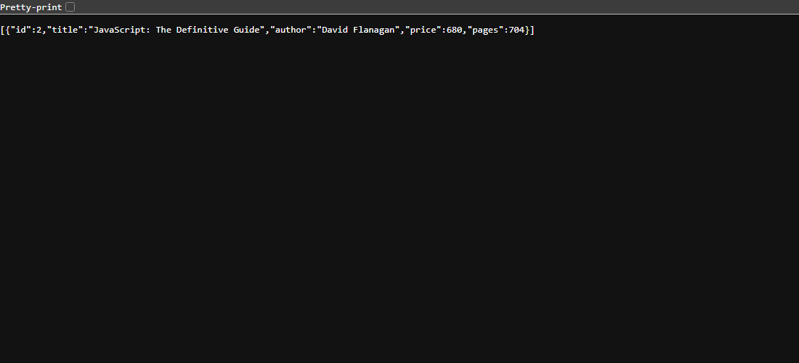

### 2. Sort by Price Descending (`screenshots/sort.png`)
Query parameter `order_by=price&order=DESC&limit=5` returning top 5 most expensive books.
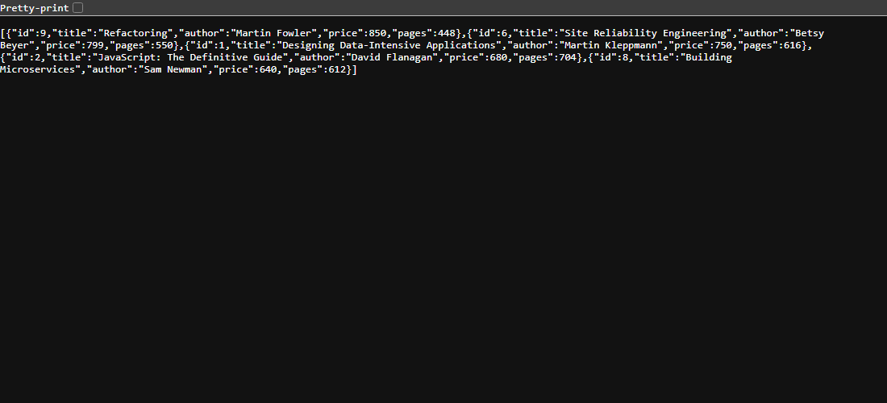

### 3. Pagination (`screenshots/pagination.png`)
Query parameters `limit=3&offset=3` returning the second page of 3 books.
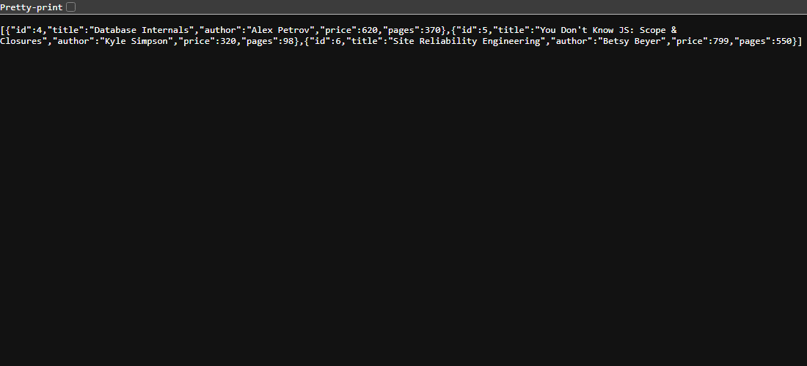

### 4. Price Range Filter (`screenshots/price-range.png`)
Query parameters `min_price=250&max_price=400` returning books within the range.
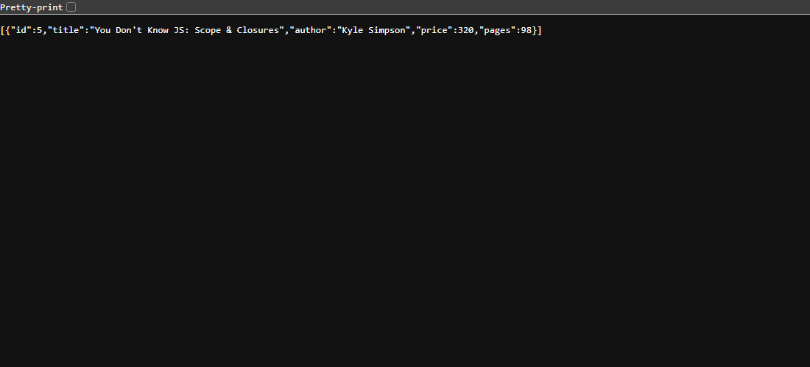

### 5. POST Create Book (`screenshots/post-created.png`)
Creating a new book returning status `201 Created` with generated ID.
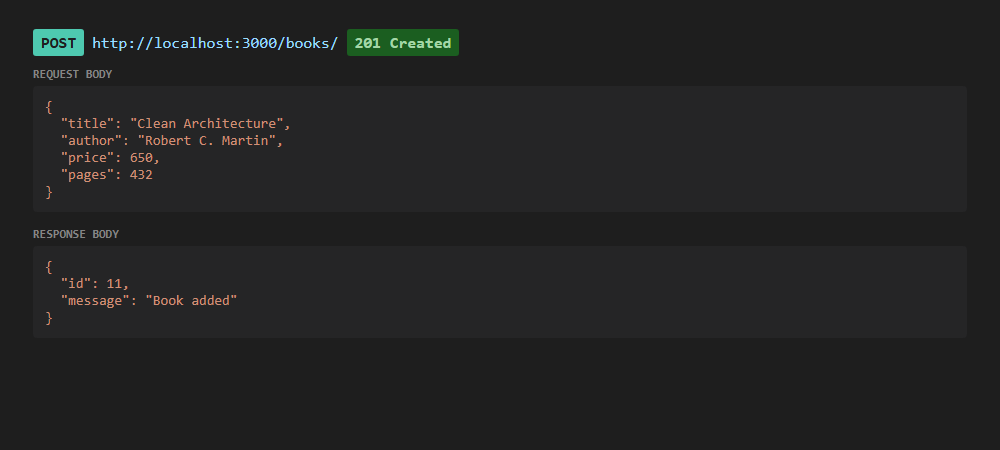

### 6. PUT Update Book (`screenshots/put-updated.png`)
Updating all fields of the created book returning status `200 OK`.
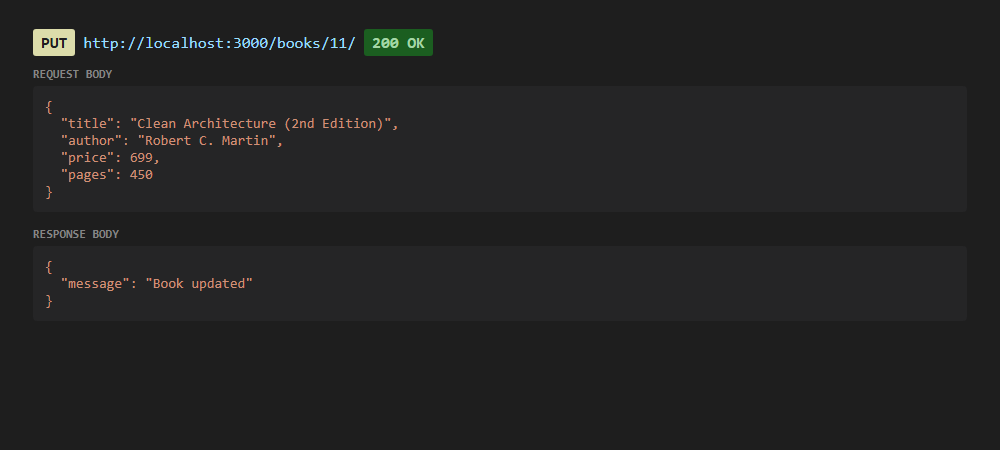

### 7. DELETE Book (`screenshots/delete-deleted.png`)
Deleting the created book returning status `200 OK`.
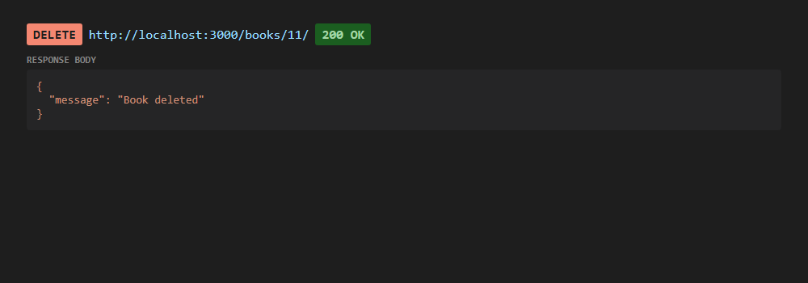

### 8. Validation Error: Missing Title (`screenshots/validation-error.png`)
POST request omitting `title` returning status `400 Bad Request`.
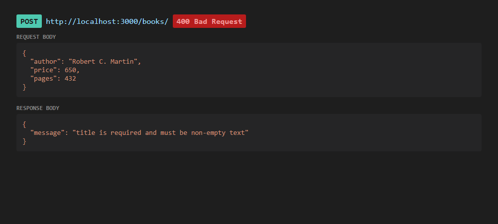

### 9. Validation Error: Non-numeric Price (`screenshots/bad-price.png`)
POST request with `price: "abc"` returning status `400 Bad Request`.
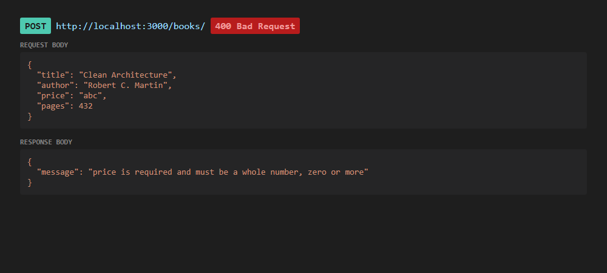

### 10. Book Not Found (`screenshots/not-found.png`)
GET request for nonexistent ID `/books/999/` returning status `404 Not Found`.
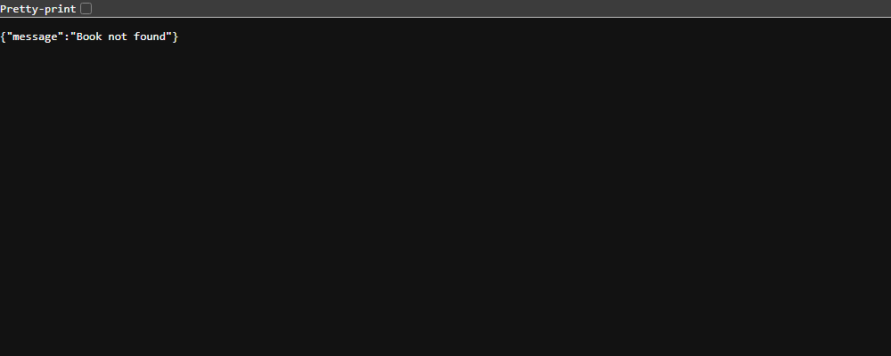

### 11. Postman Runner Results (`screenshots/runner-results.png`)
Postman Collection Runner summary showing all 30 tests passing (100% pass rate).
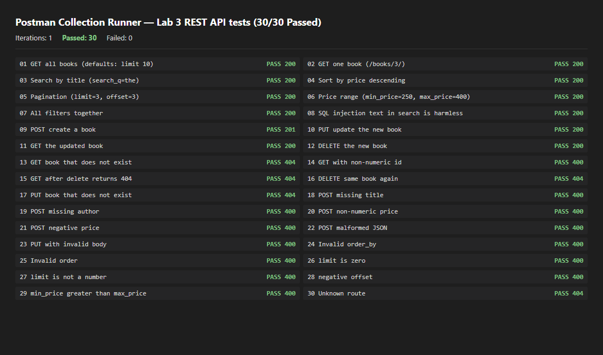

## Debugging Exercise

| Error | Message I saw | Cause | Fix |
| --- | --- | --- | --- |
| [TO BE FILLED BY STUDENT with the real errors and messages from the faculty's broken project] | | | |

*(Note: Fill this table with the actual errors, logs, causes, and fixes from the faculty's debugging assignment exercise).*

## Viva Questions and Answers

### 1. What is the difference between query parameters and path parameters in REST APIs?
- **Path Parameters** (e.g. `/books/:bookId`) identify a specific resource entity in the hierarchical URI structure. They are mandatory parts of the URL endpoint path.
- **Query Parameters** (e.g. `/books/?search_q=the&order_by=price`) are optional key-value pairs appended after `?` used to filter, sort, paginate, or customize the presentation of the requested resource collection without altering the underlying resource route.

### 2. Why is `order_by` validated against an allowed whitelist instead of using a `?` placeholder?
In SQL, parameterized `?` placeholders can only bind **data literals** (values like strings, numbers, and dates). Database engines do not permit column names, table names, or SQL keywords to be substituted as placeholders because query execution plans must be pre-compiled with known schema identifiers. Therefore, dynamic column sorting must be strictly validated against a hardcoded whitelist of allowed column names before being interpolated into the query string.

### 3. How does the `LIKE` operator with `%` wildcards work in SQLite?
The `LIKE` operator performs case-insensitive pattern matching in SQLite. The `%` character serves as a wildcard matching zero or more characters. Wrapping search terms in `%term%` matches any string that contains the term as a substring. To prevent user input containing `%` or `_` from being interpreted as wildcards, input is sanitized with `ESCAPE '\\'` syntax.

### 4. How do `LIMIT` and `OFFSET` implement database pagination?
- **`LIMIT`** specifies the maximum number of records the database engine should return for the current query (page size).
- **`OFFSET`** specifies the number of rows to skip from the beginning of the result set before returning rows.
- Together, they enable windowed data fetching: Page $N$ with size $S$ is queried using `LIMIT S OFFSET (N - 1) * S`.

### 5. Why should a malformed or non-numeric ID return HTTP 400, while a non-existent ID returns HTTP 404?
- **HTTP 400 Bad Request** indicates client syntax error: the request failed validation because `bookId` did not satisfy the structural requirement of being a positive integer (e.g., sending `/books/abc/`).
- **HTTP 404 Not Found** indicates semantic lookup failure: the request format was syntactically valid (e.g., sending `/books/999/`), but the resource does not exist in the database.

## Problems Faced and Solutions

1. **PowerShell `<` Redirection Parsing Conflict:**
   - *Problem:* Running `sqlite3 books.db < seed.sql` in Windows PowerShell triggered a native command parsing error because `<` is reserved in PowerShell.
   - *Solution:* Used SQLite CLI's native command `sqlite3 books.db ".read seed.sql"` which executes cleanly across all Windows shells.

2. **Database Table Drop on Re-seeding:**
   - *Problem:* Running `.read seed.sql` repeatedly against an existing database threw `table book already exists` and duplicated seed records.
   - *Solution:* Added `DROP TABLE IF EXISTS book;` at the beginning of `seed.sql` to ensure idempotent, clean database rebuilding.

3. **Whitelist Validation for Dynamic SQL Identifiers:**
   - *Problem:* Attempting to parameterize `ORDER BY ? ?` with SQLite placeholders treated the column name as a string literal rather than a column identifier, causing incorrect sorting.
   - *Solution:* Implemented whitelist checking for `ALLOWED_COLUMNS` and `ALLOWED_DIRECTIONS`, interpolating only validated values into the query.

## Git and Repository Notes

- **`books.db` Decision:** `books.db` is committed in its seeded 10-row state for immediate evaluation upon cloning, while `seed.sql` remains the reproducible source of truth.
- `node_modules/`, `.env`, and test runners (`test-runner.js`) are excluded via `.gitignore`.
- Screenshots are tracked under `screenshots/` using relative Markdown links.
